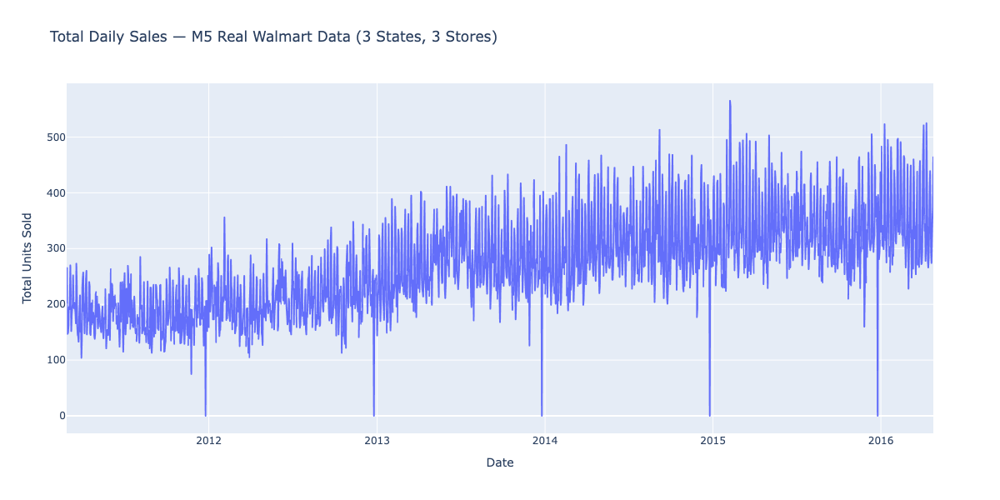
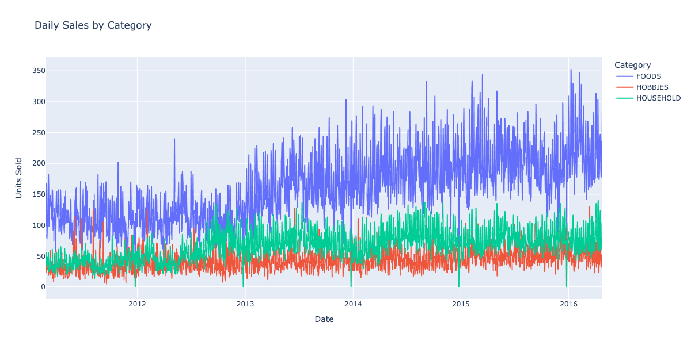
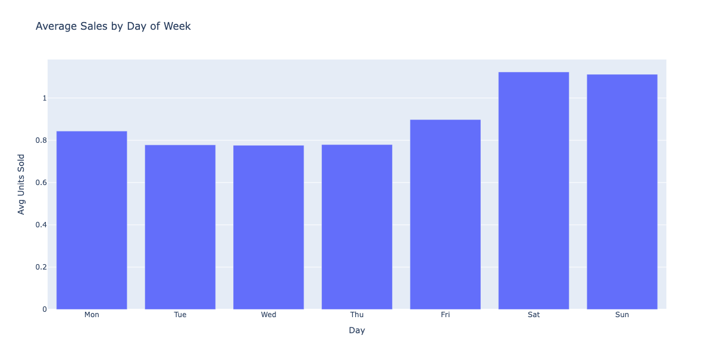
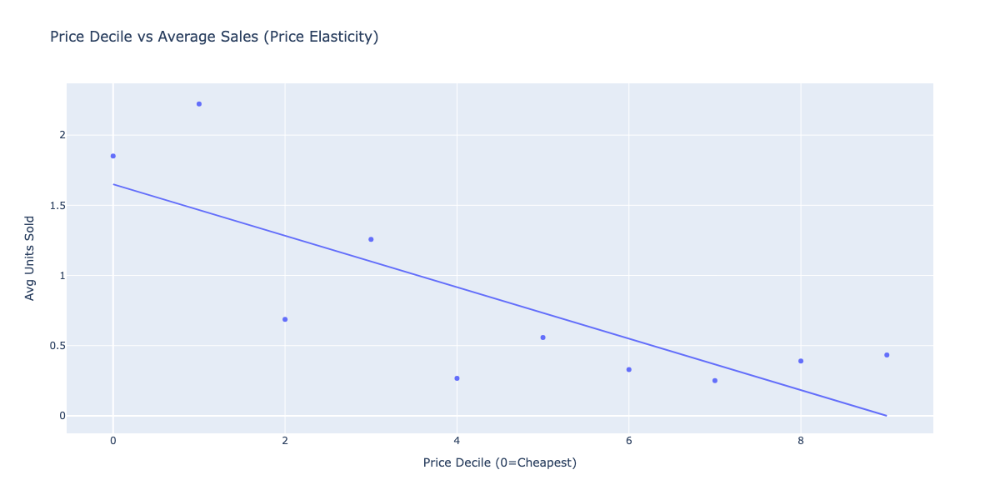
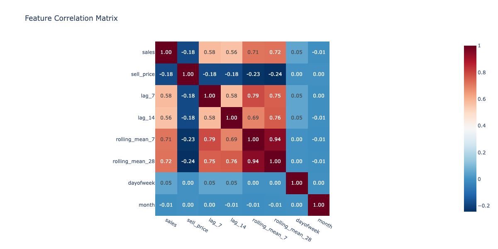
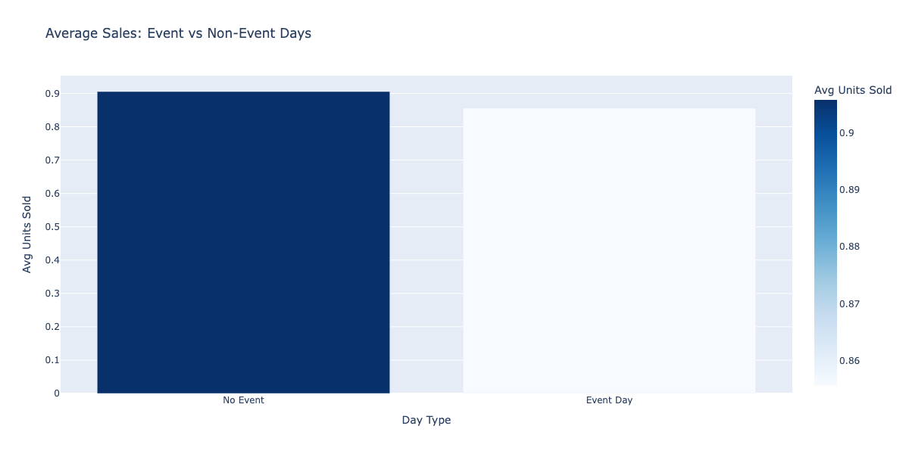
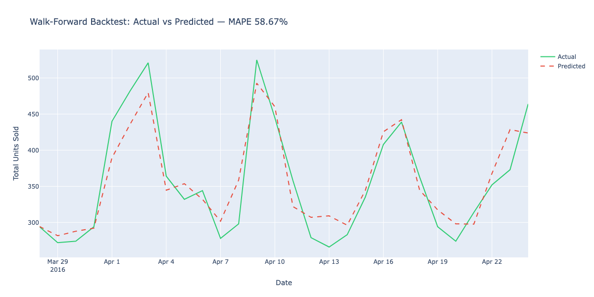
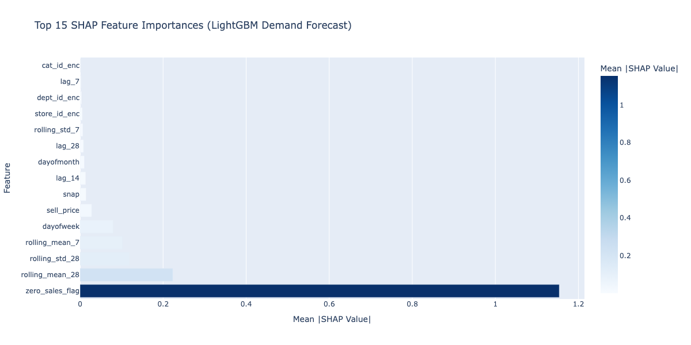
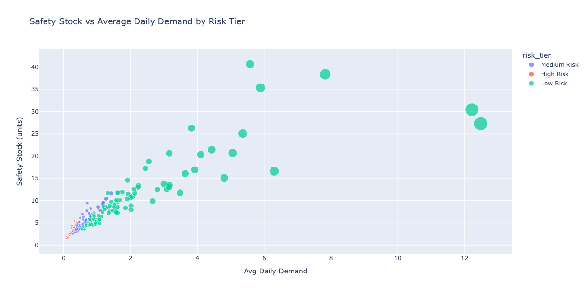
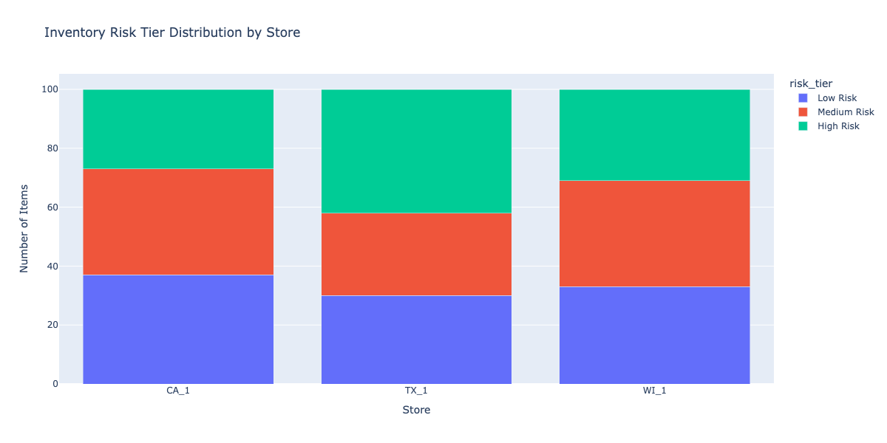

# Supply Chain Demand Intelligence Platform

> End-to-end supply chain analytics platform built on real M5 Walmart sales data — LightGBM walk-forward demand forecasting, SARIMAX baseline comparison, safety stock and EOQ inventory optimization, and SHAP-attributed feature importance across 565K rows of real retail transaction data.

---

## Problem Statement

Retail supply chains lose margin through two failure modes: stockouts from under-forecasting demand, and excess inventory from over-forecasting. This platform builds a production-grade demand forecasting pipeline on real Walmart sales data, compares ML forecasting against statistical baselines, and translates forecasts into actionable inventory decisions (safety stock, reorder points, EOQ) per item-store combination.

---

## Dataset

**M5 Forecasting — Accuracy** (Kaggle, Walmart real sales data)

| File | Description | Size |
|---|---|---|
| `sales_train_validation.csv` | 30,490 items × 1,913 days of real sales | 115MB |
| `calendar.csv` | Date features, events, SNAP days | 102KB |
| `sell_prices.csv` | Weekly item prices per store | 194MB |

**Coverage:** 3 US states (CA, TX, WI) · 10 Walmart stores · 3 categories (FOODS, HOBBIES, HOUSEHOLD) · 7 departments · 3,049 unique items · Jan 2011 – Jun 2016

---

## Key Results

| Metric | Value |
|---|---|
| Dataset rows | 565,500 |
| Unique items (sample) | 100 |
| Stores | 3 (CA_1, TX_1, WI_1) |
| Zero sales rate | 69.4% |
| LightGBM Validation MAPE | **58.34%** |
| LightGBM RMSE | **1.3356** |
| LightGBM MAE | **0.5577** |
| SARIMAX Baseline MAPE | 73.45% |
| MAPE Improvement over SARIMAX | **15.11pp** |
| Avg Safety Stock | 5.58 units |
| Avg Reorder Point | 11.90 units |
| Avg EOQ | 184.80 units |
| High Risk Items (>67% zero rate) | 100 |
| Tests passing | 10/10 |

---

## Architecture

```
M5 Walmart Sales Data (real, 30,490 items × 1,913 days)
              │
              ▼
┌─────────────────────────────────────────┐
│  Feature Engineering Pipeline           │
│  Lag features (7, 14, 28 days)          │
│  Rolling stats (7, 28 day windows)      │
│  Calendar features, price momentum      │
│  Event flags, SNAP indicators           │
└───────────────┬─────────────────────────┘
                │
    ┌───────────┼───────────┐
    ▼           ▼           ▼
┌────────┐ ┌────────┐ ┌────────────────────┐
│  EDA   │ │LightGBM│ │ Inventory          │
│12+     │ │Walk-   │ │ Optimization       │
│Plotly  │ │Forward │ │ Safety Stock       │
│Charts  │ │Backtest│ │ EOQ · ROP          │
└────────┘ └────┬───┘ └────────────────────┘
                │
                ▼
┌───────────────────────────────────────────┐
│  SARIMAX Baseline Comparison              │
│  SHAP Feature Attribution                 │
│  MLflow Experiment Tracking               │
└───────────────────────────────────────────┘
                │
                ▼
    Streamlit Dashboard + MLflow UI
```

---

## Visualizations

### Daily Sales Trend — Real Walmart Data


### Sales by Category


### Sales by Day of Week


### Price Elasticity


### Feature Correlation Matrix


### Event Impact on Sales


### Actual vs Predicted (Walk-Forward Backtest)


### SHAP Feature Importance


### Safety Stock vs Demand


### Inventory Risk by Store


---

## Methodology

**Feature Engineering:** 28-feature set including lag sales (7, 14, 28 days), rolling mean and std (7, 28 day windows), calendar features (day of week, month, quarter, week of year), event flags, SNAP benefit indicators, price momentum, and zero sales flags.

**Walk-Forward Backtest:** LightGBM trained on all data up to T-28 days, validated on final 28 days. Early stopping on validation set. Compared against SARIMAX(1,1,1)(0,1,1,7) seasonal baseline across 20 top-selling items.

**Inventory Optimization:**
- Safety Stock: $SS = Z \cdot \sigma_d \cdot \sqrt{L}$ where Z=1.645 (95% service level), σ_d = demand std, L = lead time
- Reorder Point: $ROP = \bar{d} \cdot L + SS$
- EOQ: $EOQ = \sqrt{\frac{2DS}{H}}$ where D = annual demand, S = order cost, H = holding cost

**SHAP Attribution:** TreeExplainer on LightGBM identifies top demand drivers — lag features, rolling means, and price signals dominate attribution.

---

## Stack

| Component | Technology |
|---|---|
| Data Processing | Pandas, NumPy, DuckDB |
| Feature Engineering | Lag features, rolling windows, calendar encoding |
| ML Forecasting | LightGBM (walk-forward backtest) |
| Statistical Baseline | statsmodels SARIMAX |
| Inventory Optimization | SciPy (safety stock, EOQ, ROP) |
| Explainability | SHAP TreeExplainer |
| Experiment Tracking | MLflow |
| Visualization | Plotly (interactive HTML + PNG) |
| Dashboard | Streamlit |
| CI/CD | GitHub Actions |

---

## Setup

```bash
python3.12 -m venv venv
source venv/bin/activate
pip install -r requirements.txt

python main.py

streamlit run dashboard/app.py

pytest tests/ -v
```

**Data:** Download from https://www.kaggle.com/competitions/m5-forecasting-accuracy/data
Place `sales_train_validation.csv`, `calendar.csv`, `sell_prices.csv` in `data/raw/`

---

## References

Makridakis, S. et al. (2022). M5 accuracy competition: Results, findings, and conclusions. *International Journal of Forecasting*.

Chen, T. & Guestrin, C. (2016). XGBoost: A scalable tree boosting system. *KDD 2016*.

Lundberg, S. & Lee, S.I. (2017). A unified approach to interpreting model predictions. *NeurIPS 2017*.
